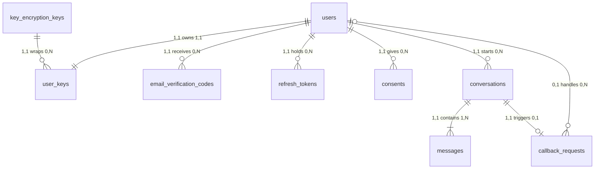
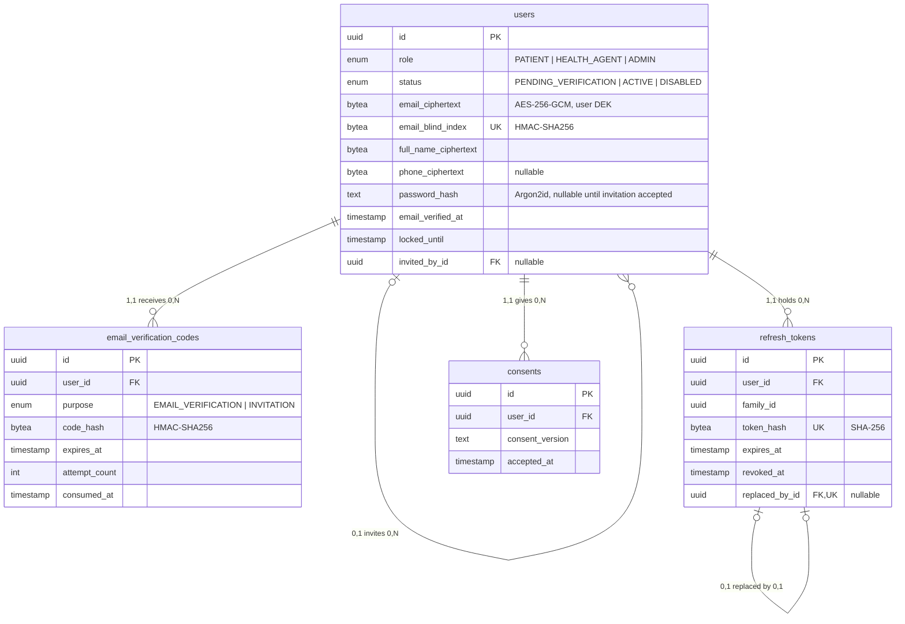
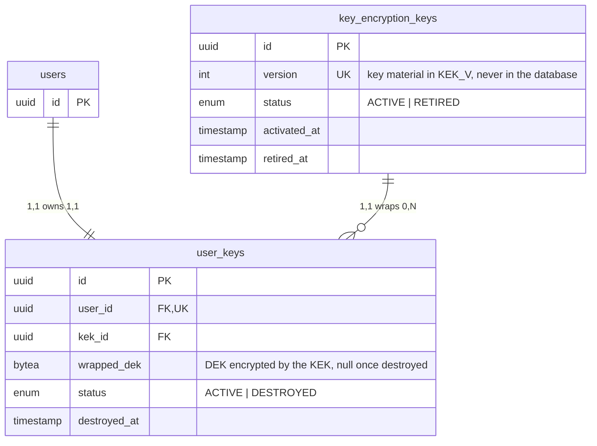
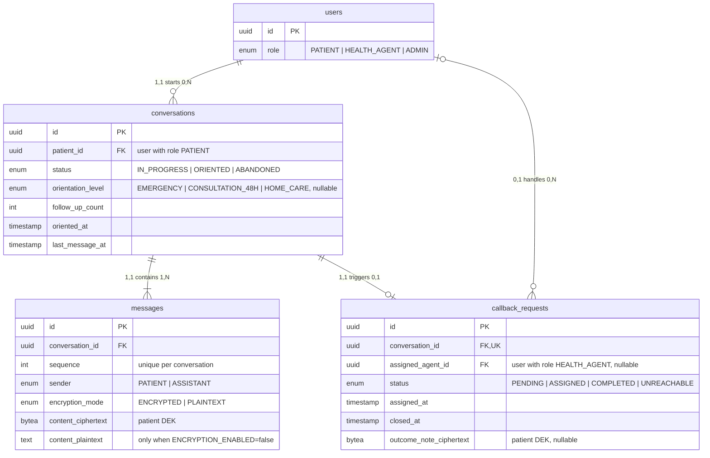

# Orienta — Data model overview (backend)

> Companion file to `orienta-backend-tdr.md` (section 5). The full column list, types and constraints stay in the TDR; this file shows how the tables relate to each other.
> Diagrams are split by domain for readability. Only keys and the most important columns are shown.

## How to read the links

Each link carries two cardinalities written as **minimum,maximum**. Each pair sits next to the table it counts, and is read from the other table:

| Cardinality | Meaning |
| --- | --- |
| `0,1` | zero or one |
| `1,1` | exactly one |
| `0,N` | zero, one or many |
| `1,N` | at least one, possibly many |

Example: `conversations` — `"1,1 contains 1,N"` — `messages` reads:

- one conversation contains **1,N** messages;
- one message is linked to **1,1** conversation (always exactly one).

The line ends drawn by Mermaid show the same thing: a bar `|` means "one", a circle `o` means "zero is allowed", a crow's foot `{` means "many".

In the attribute lists: **PK** primary key · **FK** foreign key · **UK** unique value.

The diagrams describe the `chatbot-with-encryption` branch. Every encrypted field is stored as two columns, `<field>_ciphertext` and `<field>_nonce`; diagrams show only the `_ciphertext` column. In the `chatbot-without-encryption` branch, each pair is a single plain-text column (`users.email` UK, `users.full_name`, `users.phone`, `messages.content`, `callback_requests.outcome_note`), and the tables `user_keys` and `key_encryption_keys` do not exist (section 3 below).

---

## 1. Global map

How the domains connect, without columns.

---

## 2. Accounts and authentication

---

## 3. Encryption keys (`chatbot-with-encryption` only)

---

## 4. Conversations and callbacks

---

## Tables without foreign keys

- `key_encryption_keys` holds only metadata about master keys; it is referenced by `user_keys` but references nothing.
- `audit_logs` stores `actor_id` and `resource_id` as plain identifiers, without foreign keys, so the audit trail survives the deletion or crypto-shredding of any account or resource.
